# Velora Drive

> **Complemento opcional de [OfflineTune](https://github.com/aceIHeiI/OfflineTune)**, la app principal (reproductor de música para el celular). Velora Drive es solo el launcher que va en el **estéreo Android del coche**. Si lo que buscas es escuchar tu música sin internet en el celular, descarga OfflineTune.

**Velora Drive** es un launcher (pantalla de inicio) para estéreos Android de coche, pensado para pantallas de 7", 9" y 10" (1024×600). Junta en una sola pantalla lo que usas manejando: lo que suena, tus apps, la radio, el video, los medidores del coche y el audio.

  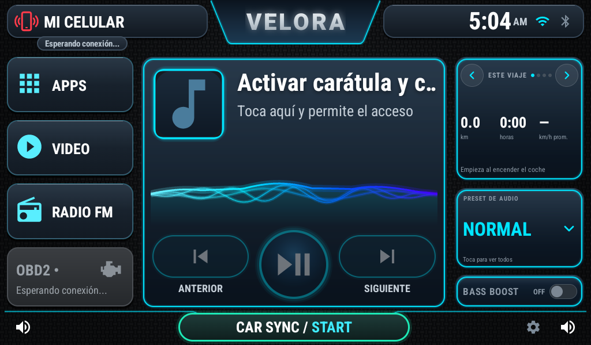

## ✨ Qué hace

- 🏠 **Pantalla principal** con la música que suena, hora, atajos a Apps, Video, Radio FM y OBD2.
- 🎵 **Reproductor** con carátula, onda animada y controles grandes. Funciona con la música que suene en el estéreo.
- 📲 **Conexión con [OfflineTune Car](https://github.com/aceIHeiI/OfflineTune/releases/latest)** por WiFi (hotspot del celular): el estéreo no necesita internet propio, el celular le manda la canción, la portada y el video.
- 📺 **Video sobre Android Auto**: el video del celular se abre encima de Android Auto y, como ventanita flotante, sigues viendo Google Maps.
- 🎬 **Video** que le manda OfflineTune Car, con biblioteca, calidad automática o manual y reproductor propio.
- 🚗 **OBD2**: medidores en vivo con un escáner ELM327 por Bluetooth, códigos de falla y un modo demo para probar sin escáner.
- 🧭 **Viaje**: kilómetros, tiempo y velocidad promedio del trayecto.
- 🎚️ **Presets de audio** y **Bass Boost** que se enciende y apaga aparte.
- 🧩 **Modo dividido**: Maps o Waze a pantalla completa con un mini reproductor encima.
- 🌙 **Protector de pantalla** con reloj grande.
- 🎨 **Colores y botones a tu gusto**: elige qué app abre cada botón y el emblema de tu coche (formas genéricas con tu marca en texto).

## 📱 Capturas

  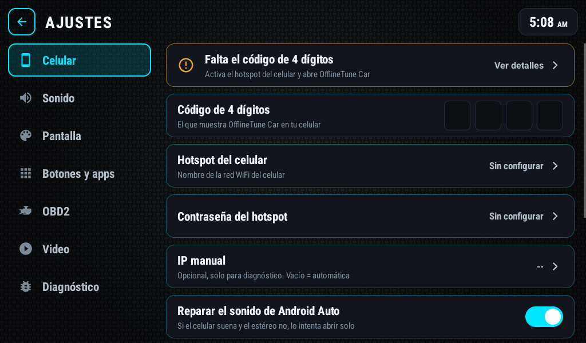
  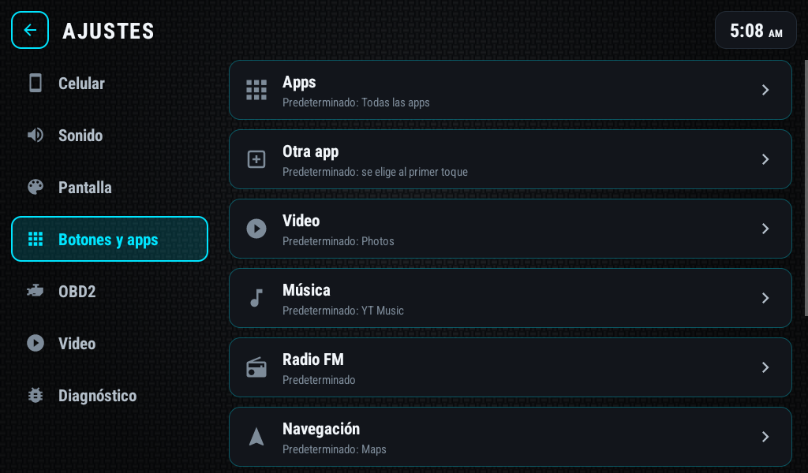

## ⬇️ Instalación

1. Ve a **[Releases](https://github.com/aceIHeiI/VeloraDrive/releases/latest)** y descarga el `.apk` (`VeloraDrive-1.0.2.apk`).
2. Instálalo en tu estéreo (puede pedir permitir apps de fuentes desconocidas).
3. Pulsa el botón de inicio y elige **Velora Drive** como launcher.
4. Para usar la música y el video de tu celular, sigue **Conectar con tu celular**, aquí abajo.

Para actualizar, instala la versión nueva encima. Si antes tenías la 1.0.0, se actualiza sin perder tus ajustes.

## 📺 Android Auto + video

Manda un video de tu celular al estéreo y se abre **encima de Android Auto**. Con un toque lo conviertes en una **ventanita flotante** y sigues viendo **Google Maps** mientras suena. Si cambias de video o avanzas la lista desde el celular, la ventana **no se maximiza** ni te tapa el mapa.

  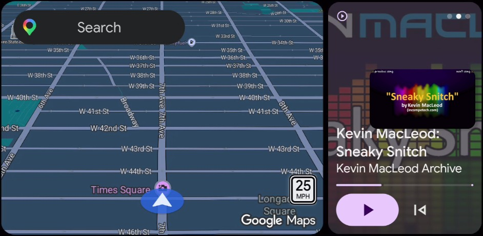
  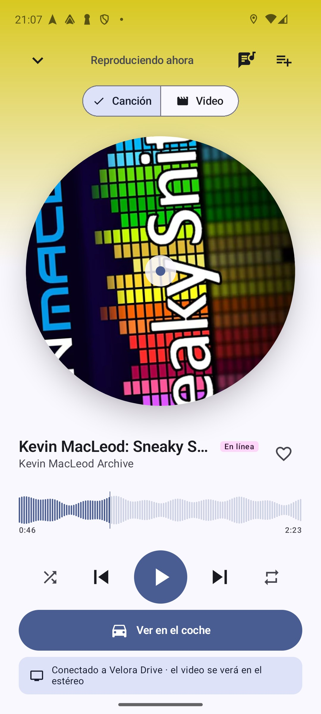

Pasos: en el celular abre un video en OfflineTune Car y toca **Ver en el coche**; en el estéreo toca **Mini** para dejarlo flotando sobre Android Auto. Configuración en la sección de abajo.

⚠️ Ve videos solo con el coche detenido.

## 📲 Conectar con tu celular (OfflineTune Car)

**Qué necesitas**

- Un celular Android con **[OfflineTune Car](https://github.com/aceIHeiI/OfflineTune/releases/latest)** (archivo `OfflineTune-Car-v….apk`).
- Que el celular y el estéreo estén en la **misma red WiFi**. Lo más estable es el *hotspot* del celular, con nombre y contraseña fijos y guardado una vez en el estéreo; se conectan solos cada vez. También sirve la red del estéreo o un router, mientras estén juntos.
- El **Bluetooth** del estéreo emparejado con el celular: el sonido va por Bluetooth, no por WiFi.

**Pasos (solo la primera vez)**

  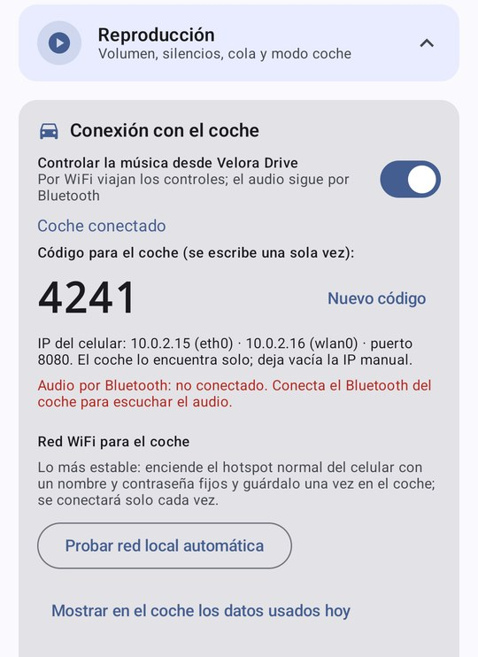
  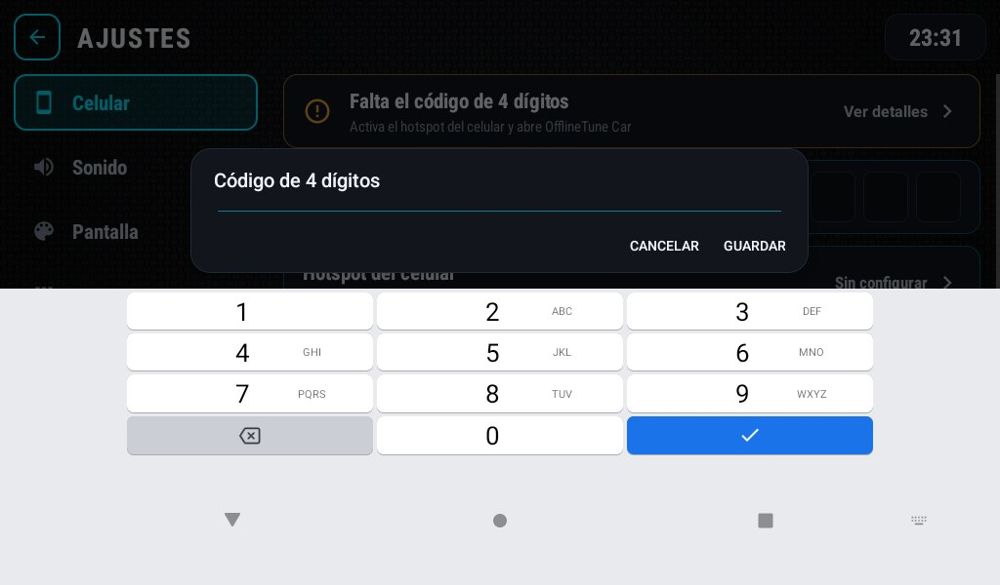

1. En el celular abre OfflineTune Car → **Ajustes › Reproducción › Conexión con el coche**. Con el interruptor encendido verás un **código de 4 dígitos**.
2. En el estéreo abre Velora Drive → **Ajustes › Celular** → **Código de 4 dígitos** y escríbelo.
3. Velora lo busca solo en la red. Cuando diga **Conectado**, ya está.

  
  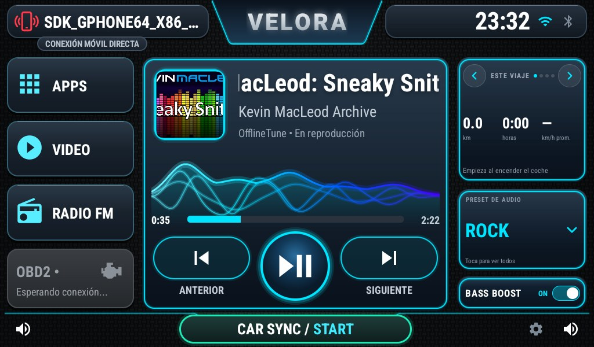

**Qué puedes hacer desde el estéreo:** pausar, siguiente y anterior, volumen, elegir el preset de audio y encender o apagar el **Bass Boost**.

  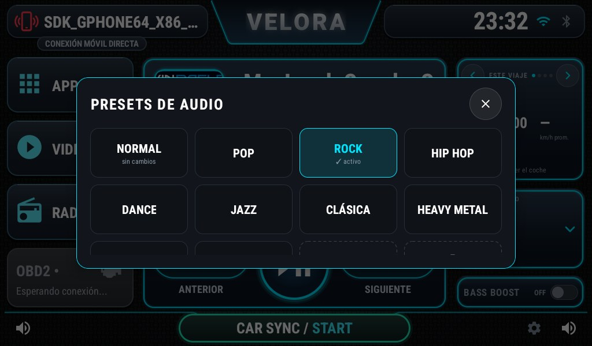
  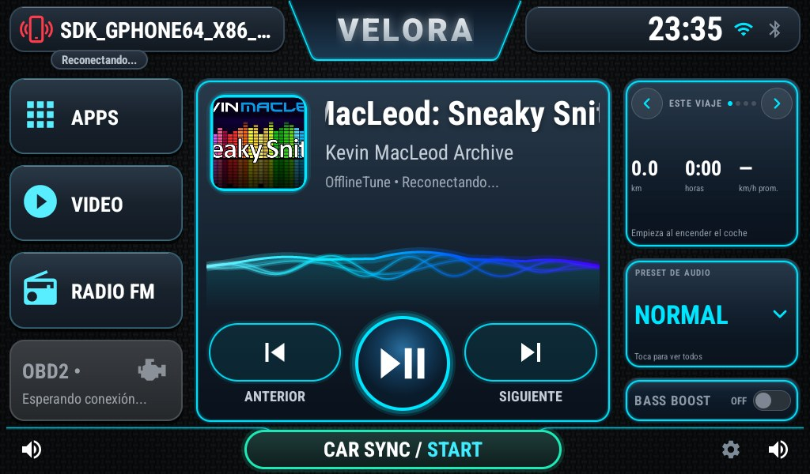

Si se corta la conexión, Velora muestra **Reconectando…** con la última canción y reintenta sola; cuando el celular vuelve, sigue donde iba.

**Video.** En el reproductor de OfflineTune Car toca **Ver en el coche**. Los botones de siguiente y anterior del estéreo siguen la lista del celular, al terminar un video pasa solo al siguiente y, si cambias de canción en el celular, el video nuevo llega al coche sin volver a pulsar nada. Si cierras el reproductor del celular con la X, el video se cierra también en el estéreo. El video empieza en la calidad más baja (144p) y puedes subirla desde el menú **Calidad** del estéreo; Velora recuerda la que elijas. Si ves un video en el estéreo y sales, la música continúa en el punto donde ibas.

  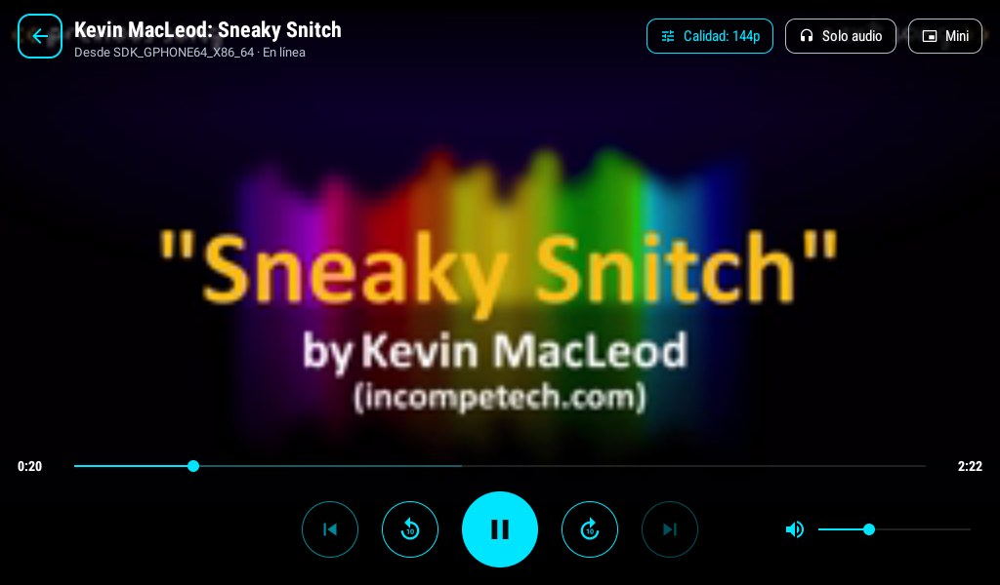
  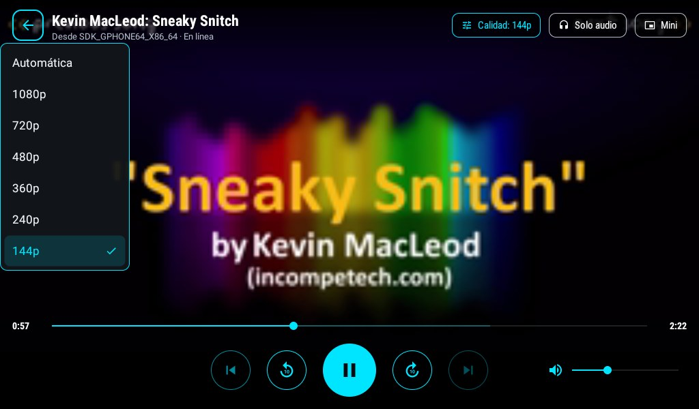

  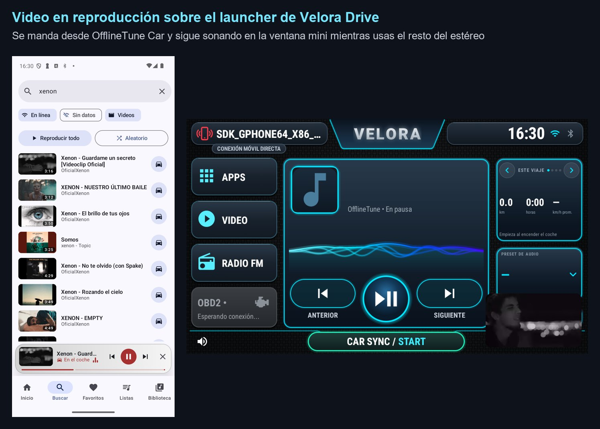

  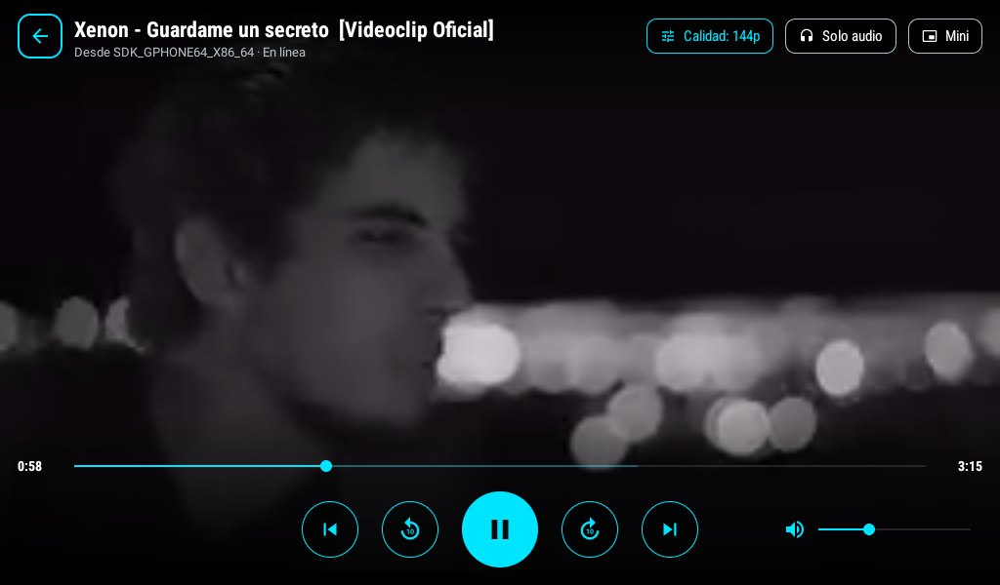

Si dejas el video en la **ventana mini** (botón *Mini*), al cambiar de video desde el celular se carga ahí mismo y no se maximiza: puedes seguir viendo el mapa u otra app.

**Mini reproductor sobre el mapa o Android Auto.** En **Ajustes › Celular** hay un interruptor para dejar el mini reproductor encima del mapa o de la app de enlace del estéreo (ZLink, Android Auto…). Pide el permiso "mostrar sobre otras apps" la primera vez.

## 🛠️ Solución de problemas

| Qué ves | Qué hacer |
|---|---|
| **"Falta el código"** o **código incorrecto** | Escríbelo igual que aparece en el celular (Ajustes › Reproducción › Conexión con el coche). Si pulsaste *Nuevo código* en el celular, escribe el nuevo. |
| **"Esperando conexión…"** que no cambia | Revisa que celular y estéreo estén en la misma red, que OfflineTune Car esté abierta con el interruptor encendido y que el ahorro de batería no la cierre. |
| **"Reconectando…"** | Es normal unos segundos si cambió el WiFi o bloqueaste el celular. Si sigue, abre OfflineTune Car en el celular. |
| **Se ve la canción pero no suena** | El audio va por Bluetooth: conecta el Bluetooth del celular al estéreo. Velora avisa "Conecta el Bluetooth para escuchar el audio". |
| **No hay video o dice que la canción no tiene video** | El video solo existe para canciones con identificador de YouTube (las descargadas desde Buscar). Las importadas de tu carpeta no lo tienen. |

✅ **Probado en un celular y un estéreo Android reales.** Si encuentras algo raro, cuéntame en un [Issue](https://github.com/aceIHeiI/VeloraDrive/issues).

## 🔐 Permisos y para qué sirven

Velora Drive no tiene cuentas ni anuncios y **no envía datos a ningún servidor**. Solo se comunica con tu celular por la red local.

| Permiso | Para qué |
|---|---|
| Mostrar sobre otras apps | El mini reproductor del modo dividido. |
| Acceso a notificaciones | Leer qué canción suena en el estéreo para mostrarla y controlarla. |
| Ubicación (y servicio en primer plano) | Velocidad y kilómetros del viaje. |
| Micrófono / audio | Solo analiza el volumen de la música para animar la onda; no graba. |
| Bluetooth | Conectar el escáner OBD2. |
| Wi-Fi y red local | Hablar con OfflineTune Car en el celular. |

## ⚠️ Importante

- **No mires video ni uses el estéreo manejando.** La función de video es para cuando el coche está detenido. Usa Velora con responsabilidad y respeta las leyes de tu país.
- Los medidores OBD2 son informativos: no sustituyen el tablero de tu coche ni un diagnóstico mecánico.
- Probado en estéreos Android chinos de 1024×600. Si en el tuyo algo falla, ve a **Ajustes › Diagnóstico**, copia el resultado y abre un Issue.

## 💬 ¿Errores o ideas?

Abre un **[Issue](https://github.com/aceIHeiI/VeloraDrive/issues)**. ¡Leo todos!

## ☕ Apoya mis apps

Velora Drive y OfflineTune los hago yo solo en mi tiempo libre. Si te sirven, puedes apoyar en **[Ko-fi](https://ko-fi.com/iheii)**. 💜

## 📄 Licencia

[MIT](LICENSE) · [Política de privacidad](https://aceiheii.github.io/VeloraDrive/privacy-policy.html). Marcas y logotipos de terceros (Google Maps, Waze, etc.) pertenecen a sus dueños y se mencionan solo para indicar con qué apps funciona.
